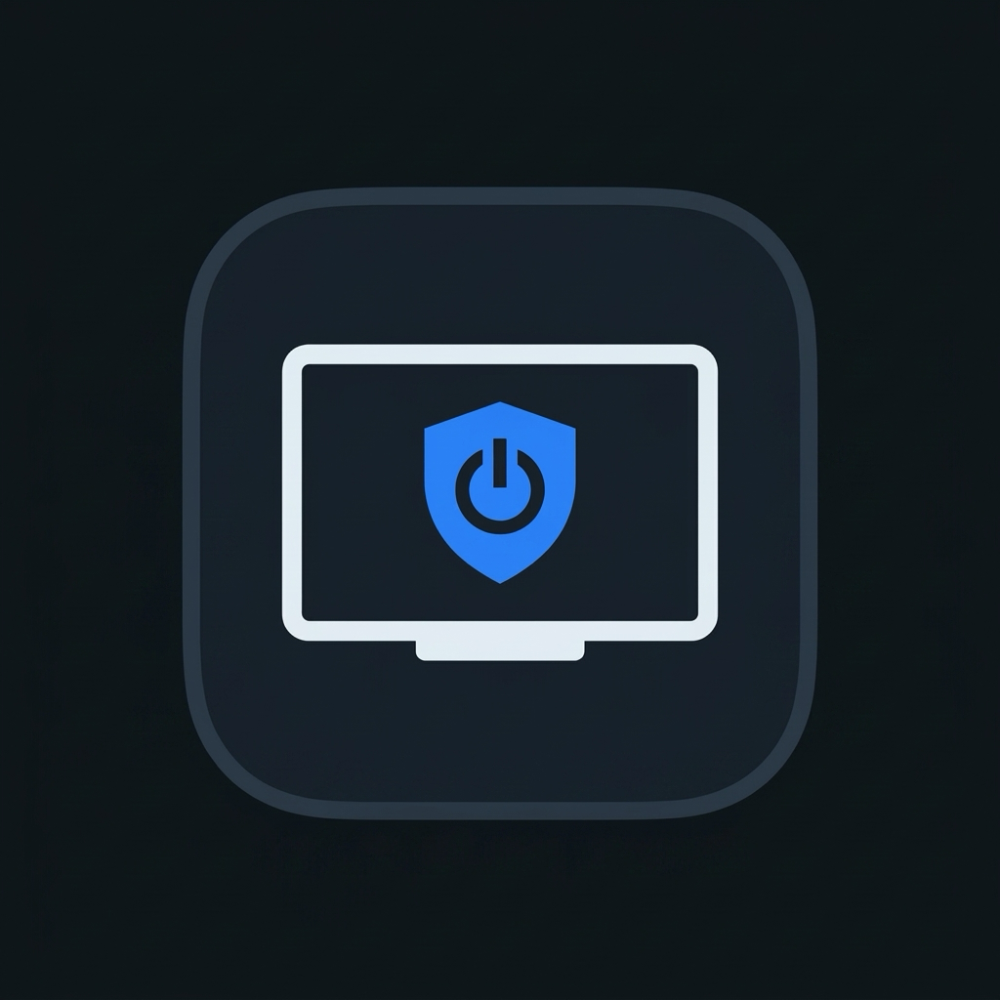

<div align="center">
  
  <h1>atvtools</h1>
  <p><strong>Take back your TV.</strong></p>
  <p>
    A fast, brick-safe, cross-platform desktop GUI &amp; CLI toolbox for Android TV and Google TV — written in Rust.
  </p>
  <p>
    <a href="https://github.com/adam2893/atvtools/releases"></a>
    
    
  </p>
</div>

---

## Why atvtools?

Smart TVs ship loaded with ad-heavy home screens, ACR tracking, OEM telemetry, and bloatware. **atvtools v5** lets you clean, debloat, customize, and control any Android TV or Google TV over Wi-Fi or USB from **macOS, Windows, or Linux** — in a single native binary with **built-in safety guards** so you don't brick your TV or lock yourself off Wi-Fi.

### Highlights in v5.2

- **Non-Blocking Desktop GUI + CLI in One Binary:** Responsive `egui` desktop app backed by background worker threads — never freezes during scans, downloads, or screenshots.
- **Click-to-Tap Live Preview & Browser Remote:** Click anywhere on the TV screenshot to tap, enable 2.5s auto-refresh mirroring, switch **HDMI 1–4 / TV Input**, or start the phone **Browser Remote (:8080)** in one click.
- **Drag-and-Drop APK Sideloading & App Permissions:** Drop any `.apk` onto the GUI window to install (with Android 14+ shell fallback), and grant `MANAGE_EXTERNAL_STORAGE` or `WRITE_SETTINGS` in one click.
- **Brick & Wi-Fi Safety Guards:**
  - Blocks disabling core Android & MediaTek/CVTE TV middleware (`com.cltv.mal`, `com.mediatek.tis`, `android.ext.services`, `com.android.location.fused`, etc.).
  - Checks `dumpsys wifi` before touching `setupwraith` so disabling it won't delete your saved Wi-Fi network.
  - Prevents disabling the last usable `HOME` launcher on the TV and blocks launching OEM factory-test menus.
- **Brand-Specific Presets & Fleet Sync:** Auto-detect TV brand (`ro.product.manufacturer`) for **TCL**, **Xiaomi (PatchWall)**, **Hisense**, **Sony Bravia**, **Philips**, and **Nvidia Shield**, or apply across all attached TVs at once.
- **Privacy, ACR & Telemetry Audit + OTA Drift Fix:** Detects Inscape/Samba/Skyworth ACR, voice assistants, and OEM telemetry; catches firmware updates that re-enable bloatware and re-disables them safely.
- **System Health, Storage, Snapshots & Logs:** At-a-glance RAM/storage/uptime health card, top-15 storage analyzer, cache trimmer, `.atvtools.toml` snapshots, filterable `logcat`/crash viewer, and `ro.adb.secure` security audit.
- **Launchers, Screensavers & Privileged Helpers:** One-click install for **tvOS Launcher** (Apple TV style), **FLauncher**, and **Projectivy**, custom screensaver picker (e.g. Aerial Views), **fork-Shizuku** or **Stellar** (`roro2239/Stellar`), **USB -> Wi-Fi (5555)** switch, **Wake-on-LAN**, and live remote keycode/scancode inspector.
- **UAD-ng Inspired ADB Engine:** Typed ADB command builder, Windows `CREATE_NO_WINDOW` support, and clear, human-readable OEM error messages.

---

## Download & Quick Start

Grab the latest ready-to-run GUI & CLI bundle from the **[Releases Page](https://github.com/adam2893/atvtools/releases)**:

| OS | Download | How to open the GUI |
| :--- | :--- | :--- |
| **macOS** (Apple Silicon & Intel) | `atvtools-v*-macos-universal.tar.gz` | Unpack and double-click **`atvtools.app`** *(first launch: right-click → Open, or `xattr -d com.apple.quarantine atvtools.app`)* |
| **Windows** (x86-64) | `atvtools-v*-x86_64-pc-windows-msvc.zip` | Unpack and double-click **`atvtools-gui.bat`** (or run `atvtools.exe gui`) |
| **Linux** (x86-64) | `atvtools-v*-x86_64-unknown-linux-gnu.tar.gz` | Unpack and run `./atvtools gui` |

> **Prerequisite:** `adb` must be installed on your `PATH` (or set `ADB=/path/to/adb`).
> - **macOS:** `brew install --cask android-platform-tools`
> - **Windows:** `winget install Google.PlatformTools`
> - **Linux:** `sudo apt install adb` (or your distro's `android-tools` package)

### Preparing Your TV (1 minute)

1. On your TV, go to **Settings → System → About** (or **Device Preferences → About**).
2. Press **OK** on **Build** 7 times until *"You are now a developer"* appears.
3. Go back to **Developer options** and turn on **USB debugging** (and **Network / ADB debugging** if shown).
4. Open **atvtools**, go to **Connect**, click **Scan Network**, and accept the **"Allow debugging?"** popup on your TV screen.

---

## Desktop GUI Overview

Launch with `atvtools gui` (or double-click `atvtools.app` / `atvtools-gui.bat`):

| Section | What You Can Do |
| :--- | :--- |
| **Connect** | Auto-scan your local network, connect by IP (`host:port`), pair Android 11+ Wireless Debugging with a 6-digit code, or switch between multiple TVs. |
| **TV Cleanup** | Guided workflow: **(1)** Privacy/ACR/Telemetry audit, **(2)** Ad-free presets, OTA drift check & one-click Undo, **(3)** Install & set custom launchers (**tvOS Launcher**, **FLauncher**, **Projectivy**) + **fork-Shizuku** or **Stellar**. |
| **Apps** | Filter third-party or system packages, batch disable (safe-guarded), enable, uninstall for user 0, launch, force-stop, or inspect. |
| **Debloat (UAD)** | Scan against the Universal Android Debloater database (`Recommended`, `Advanced`, `Expert`, `Unsafe`) with descriptions and brick protection. |
| **Settings** | Adjust display DPI & font scale, toggle **AdGuard Private DNS**, block OTA updates, toggle system flags, and jump directly to hidden Android TV settings screens. |
| **Remote & Screen** | Full D-pad & media remote, send text or URLs, wake/sleep/sync-reboot, capture inline screenshots, record MP4s, or launch `scrcpy`. |
| **Files & Catalog** | Push/pull files over ADB without an FTP app on the TV, run `doctor` diagnostics, and install curated TV apps (**SmartTube**, **Nuvio**, **Aurora Store**, **AdGuard TV**, etc.). |

---

## CLI Cheat Sheet

Every GUI action is also available as a fast, scriptable CLI subcommand (run bare `atvtools` for the interactive terminal menu):

```sh
# Connect & Diagnose
atvtools connect                              # Scan LAN for TVs on port 5555
atvtools connect 192.168.1.50                 # Connect to a known TV IP
atvtools pair 192.168.1.50:37123 --code 123456
atvtools doctor                               # Check adb, devices, internet, region, OTA, ro.adb.secure
atvtools doctor --fix                         # Restart adb server & enable TCP mode on USB TVs

# Privacy, Debloat & Drift Protection
atvtools privacy                              # Audit ACR, voice & OEM telemetry packages
atvtools privacy --disable                    # Safely disable flagged trackers (with undo)
atvtools preset apply google-tv-ads           # Disable Google TV launcher ad churn
atvtools drift --fix                          # Catch & re-disable packages restored by OTA updates
atvtools undo                                 # Re-enable the last disabled batch

# UAD Database
atvtools uad list --level recommended
atvtools uad apply --level recommended --yes

# Launchers & Privileged Helpers
atvtools install tvos-launcher                # Apple TV-style launcher (techgenius1/tvOS-Launcher)
atvtools home com.techgenius.tvoslauncher     # Set default HOME launcher
atvtools stellar install && atvtools stellar start   # Optional Stellar manager
atvtools shizuku install && atvtools shizuku start   # fork-Shizuku manager

# Settings, Apps, Remote & Screen
atvtools settings adblock-on                  # Enable AdGuard Private DNS
atvtools settings dns --provider cloudflare   # Or cloudflare / nextdns / quad9 / google
atvtools settings ota --off                   # Block OTA updates
atvtools settings set-density 320             # Change display DPI
atvtools apps install ./app.apk --replace     # Sideload APK (replacing signature clash if needed)
atvtools screen shot shot.png                 # Take TV screenshot
atvtools remote --serve                       # Serve a browser D-pad for your phone (0.0.0.0:8080)
```

---

## Build from Source

Requires Rust (`rustup`):

```sh
git clone https://github.com/adam2893/atvtools.git
cd atvtools
cargo test                 # Run unit tests
cargo build --release      # Output: target/release/atvtools (CLI + GUI)
```

---

## License

MIT — see [LICENSE](LICENSE) if present, or `Cargo.toml`.
